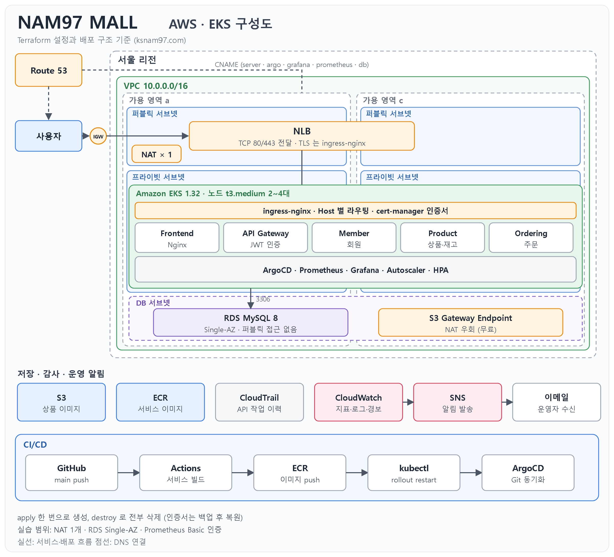
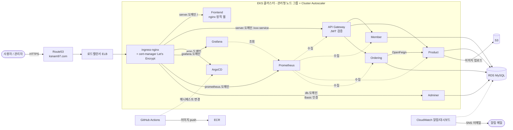

# NAM97 MALL 구성과 주요 스택

> 한 줄 요약: AWS EKS 위의 MSA 쇼핑몰. 인프라는 Terraform 한 번으로 구축하고, 배포는 GitHub Actions + ArgoCD(GitOps)로 자동화한다.

## 1. 전체 구성도





## 2. 서비스 구성

| 서비스 | 역할 | 주요 API |
|---|---|---|
| **API Gateway** | 모든 요청의 단일 진입점. JWT 검증, 사용자 ID/권한을 헤더로 전달, `/actuator` 외부 차단 | - |
| **Member** | 회원 | 가입 · 로그인 · 토큰 갱신 · 내 정보 조회/수정 · 비밀번호 변경 · 탈퇴 · (관리자) 회원 목록 |
| **Product** | 상품 | 목록 · 상세 · 등록(이미지 S3) · (관리자) 삭제 · 재고 차감/복구(내부 전용) |
| **Ordering** | 주문, 장바구니 | 주문 · 내 주문 · 주문 취소(재고 복구) · 장바구니 저장/조회 · (관리자) 전체 주문 |
| **Frontend** | 쇼핑몰 화면 | 정적 HTML/CSS/JS (nginx) |

- 서비스 간 호출: Ordering → Product를 쿠버네티스 Service DNS로 직접 호출(OpenFeign). 이 호출은 게이트웨이를 거치지 않으므로 "내부 전용" API는 게이트웨이가 붙이는 `X-User-Role` 헤더의 유무로 외부 요청과 구분한다.
- 데이터: 하나의 RDS MySQL DB(`ordermsa`)를 공유. 테이블: `member`, `product`, `ordering`, `cart_item`.
- 인증: 로그인 시 JWT(액세스/리프레시) 발급 → 게이트웨이가 검증 후 `X-User-Id`, `X-User-Role` 헤더 주입 → 각 서비스는 이 헤더만 신뢰한다.

## 3. 주요 기술 스택

| 영역 | 기술 | 선택 이유 |
|---|---|---|
| 백엔드 | Java 17, Spring Boot 3.4, Spring Cloud Gateway, OpenFeign, Spring Data JPA, jjwt | 서비스 분리, 게이트웨이/서비스 간 호출을 표준 스택으로 구현 |
| 프론트 | HTML, CSS, 순수 JavaScript, nginx | 빌드 도구 없이 가볍게. 헤더/푸터는 `app.js`가 공통 생성 |
| 컨테이너/오케스트레이션 | Docker, Amazon EKS, ingress-nginx, HPA, Cluster Autoscaler, metrics-server | 부하에 따라 파드/노드 자동 증감 |
| 데이터/저장 | Amazon RDS MySQL, Amazon S3 | 관리형 DB, 상품 이미지 저장(`products/`만 공개 읽기) |
| 인프라 코드 | Terraform (VPC, EKS, RDS, S3, ECR, Route53 레코드, Helm 애드온) | 한 번의 `apply`로 전체 재현, `destroy`로 정리 |
| CI/CD | GitHub Actions (이미지 빌드/푸시), ArgoCD (GitOps 배포) | Git이 기준. 변경된 서비스만 빌드 |
| 보안 | JWT, cert-manager(Let's Encrypt HTTPS), 쿠버네티스 시크릿, IAM 최소 권한 | 비밀 값은 소스에 두지 않음 |
| 모니터링 | Prometheus, Grafana(자동 설정된 대시보드), CloudWatch(알람/대시보드/EKS 로그), SNS 이메일 | 서비스·노드·DB 상태를 한 곳에서 확인, 이상 시 알림 |
| 운영 도구 | Adminer(DB 관리), 관리자 페이지 | Basic 인증 + DB 로그인의 이중 보호 |

## 4. 인프라 구성 (Terraform)

`terraform/` 폴더 한 곳에서 관리하며 `terraform apply` 한 번으로 아래가 순서대로 만들어진다.

```
VPC → EKS(+노드 그룹) → RDS / S3 / ECR → ingress-nginx · cert-manager · ArgoCD · autoscaler
→ 시크릿(DB/JWT/관리자/Grafana/Adminer) → DNS 레코드 → ArgoCD root app → 앱 배포 → CI 실행 → password.txt 저장
```

| 파일 | 내용 |
|---|---|
| `network.tf` / `eks.tf` | VPC(public/private 서브넷, NAT), EKS, 노드 그룹, 오토스케일러 IAM 역할(IRSA) |
| `data.tf` | ECR, S3(+공개 읽기 정책), RDS(샌드박스 사양), 쿠버네티스 시크릿, 랜덤 비밀번호 |
| `addons.tf` | ingress-nginx, cert-manager, ArgoCD, autoscaler, metrics-server |
| `dns.tf` | 기존 Route53 존에 서브도메인 CNAME만 추가 (존/NS는 건드리지 않음) |
| `monitoring.tf` | CloudWatch 알람 3종, 대시보드 |
| `certs.tf` / `cleanup.tf` | HTTPS 인증서 백업·복원, destroy 시 잔여 리소스 정리 |
| `ci.tf` / `credentials.tf` | apply 후 GitHub Actions 자동 실행, 접속 정보 `password.txt` 자동 저장 |
| `notify/` | 생성·삭제 SNS 알림 (메인과 별도 스택) |
| `bootstrap/` · `backend.tf` | 테라폼 state 저장용 S3 버킷(별도 스택, destroy해도 유지)과 메인의 원격 backend 설정 |

운영 편의: `scripts/show-credentials.ps1`(접속 주소·비밀번호 확인), `scripts/verify-destroy.ps1`(삭제 후 잔여 리소스 점검).

## 5. 배포 흐름

1. 코드를 `main`에 push
2. GitHub Actions가 변경된 서비스만 이미지로 빌드해 ECR에 push하고 롤아웃
3. ArgoCD가 `argocd/apps`의 매니페스트를 감시하며 클러스터를 Git과 동기화 (prune + self-heal)

## 6. 보안 설계

- **비밀 값 분리**: DB 비밀번호, JWT 서명 키, 관리자/Grafana/Adminer 비밀번호는 Terraform이 랜덤 생성해 시크릿으로만 전달 (소스에 없음)
- **권한 검사는 서버에서**: 화면에서 버튼을 숨기는 것과 별개로, 관리자 API는 게이트웨이가 넣는 `X-User-Role`로 서버가 검사
- **최소 권한**: CI 사용자는 `ksnam97` 네임스페이스 편집만, S3는 `products/` 읽기만 공개, 서비스 계정은 IRSA
- **입력 검증**: 이메일 형식, 비밀번호 규칙(8~64자, 영문+숫자)을 서버에서 검사, 화면 출력은 HTML 이스케이프
- **내부 지표 비공개**: `/actuator`는 게이트웨이에서 외부 접근 차단, DB 화면은 이중 인증

## 7. 운영/비용 (샌드박스)

- 실습할 때만 띄우고 끝나면 `terraform destroy` (HTTPS 인증서는 백업/복원, 발급 한도 회피)
- RDS는 최소 사양·단일 AZ, 모든 리소스에 `Environment=sandbox` 태그로 비용 추적
- 생성·삭제 시 SNS 이메일로 알림 (별도 `notify` 스택, 삭제 시에도 유지)
