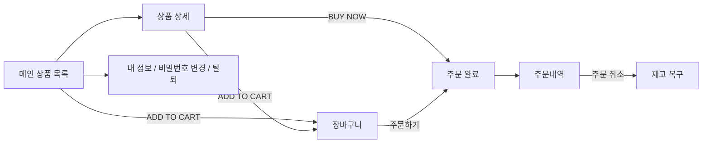

# NAM97 MALL 디자인 가이드

> 미니멀 큐레이션 몰 스타일: 흰 배경, 얇은 글꼴, 넓은 여백, 큰 상품 이미지. 색을 최소화해 상품이 주인공이 되도록 했다.

## 1. 디자인 원칙

1. **상품이 주인공**: 배경은 흰색/연회색, 강조색은 검정 한 가지. 화려한 색은 쓰지 않는다.
2. **얇고 넓게**: 가는 글꼴(300), 영문 대문자 + 자간으로 메뉴/제목을 정돈, 여백을 넉넉히.
3. **한 곳에서 관리**: 모든 색/여백은 `style.css`의 `:root` 변수 한 곳, 헤더/푸터는 `app.js`가 모든 페이지에 공통 생성.
4. **의존성 없이 가볍게**: 프레임워크·아이콘 라이브러리 없이 순수 HTML/CSS/JS, 아이콘은 인라인 SVG.

## 2. 스타일 토큰 (`msa/frontend/src/assets/style.css`)

| 토큰 | 값 | 용도 |
|---|---|---|
| `--text` | `#111` | 본문, 검정 버튼 |
| `--muted` | `#8a8a8a` | 보조 글씨, 안내 |
| `--line` | `#e8e8e8` | 구분선, 테두리 |
| `--gray` | `#f4f4f4` | 상품 이미지 배경 |
| `--danger` | `#d6352f` | 품절, 오류, 삭제 |
| `--ok` | `#1d7a46` | 성공, 정상 |
| 글꼴 | Noto Sans KR 300 / 400 | 얇은 본문 |
| 모서리 | 직각 | 버튼, 입력칸 (둥근 모서리 없음) |

## 3. 레이아웃

```
┌──────────────────────────────────────────────────────────┐
│ 공지띠  회원가입 5% 쿠폰 · 3만원 이상 무료배송             │
├──────────────────────────────────────────────────────────┤
│ NAM97   ALL  전자기기  패션  생활   🔍  🛍(수)  👤  ☰     │  ← 헤더 (고정)
├──────────────────────────────────────────────────────────┤
│ CURATED BY NAM97                    8 items  [NEWEST ▾]  │
│ 카테고리                                                  │
│ 상품명                                                    │
│ 가격                                                      │
│ ┌────────┐ ┌────────┐ ┌────────┐ ┌────────┐             │  ← 4열 그리드
│ │ 이미지 │ │ 이미지 │ │ 이미지 │ │ 이미지 │             │     (태블릿 3열, 모바일 2열)
│ │ADD CART│ │        │ │        │ │        │             │
│ └────────┘ └────────┘ └────────┘ └────────┘             │
└──────────────────────────────────────────────────────────┘
```

- **헤더**: 로고(좌) / 카테고리 메뉴(중앙, 상품의 카테고리로 자동 생성) / 아이콘(우: 검색, 장바구니, 계정, 모바일 메뉴)
- **카드**: 텍스트(카테고리/이름/가격)가 위, 큰 이미지가 아래. 마우스를 올리면 이미지 확대 + `ADD TO CART` 표시, 품절/잔여 수량 뱃지
- **반응형**: 800px 이하에서 2열 그리드, 카테고리는 햄버거 메뉴, 담기 버튼은 항상 표시

## 4. 페이지 구성

| 영역 | 페이지 | 설명 |
|---|---|---|
| 쇼핑 | `index.html` | 상품 목록: 카테고리, 검색, 정렬 |
| | `product-detail.html` | 수량 선택, 장바구니, 바로 구매 |
| | `cart.html` | 장바구니(서버에 저장되어 기기를 바꿔도 유지) → 주문하기 |
| | `orders.html` | 내 주문내역, 주문 취소(재고 복구) |
| 회원 | `signup.html` / `login.html` | 가입(이메일·비밀번호 규칙 안내), 로그인 |
| | `mypage.html` | 내 정보 수정, 이메일 변경, 비밀번호 변경 |
| | `withdraw.html` | 회원탈퇴(비밀번호 확인) |
| 관리자 | `admin.html` | 서비스 상태, 운영 도구 링크, 주문 관리, 회원 관리(회원별 상세/주문) |
| | `product-create.html` | 상품 등록(이미지 업로드) |

## 5. 사용자 흐름



관리자 흐름: 로그인 → 계정 메뉴의 **관리자** → 서비스 상태 확인 → Grafana / Prometheus / ArgoCD / DB / CloudWatch 이동 → 주문 취소, 회원·주문 조회, 상품 등록/삭제.

## 6. 사용자 경험 세부

- **알림**: `alert` 대신 우하단 토스트(장바구니 담기 등), 로딩 중에는 회색 스켈레톤
- **중복 방지**: 등록/주문 버튼은 요청 중 잠금 (같은 상품이 여러 개 등록되던 문제 해결)
- **접근성**: 키보드 포커스 표시, 이미지 대체 텍스트, 입력칸 라벨
- **장바구니**: 비로그인 시 브라우저에 저장, 로그인하면 서버 장바구니와 병합(같은 상품은 수량이 큰 쪽, 품절/삭제 상품 제외)

## 7. 입력 규칙 (화면 안내 = 서버 검사)

| 항목 | 규칙 |
|---|---|
| 이메일 | 공백 없는 `아이디@도메인.최상위도메인`, 100자 이하 |
| 비밀번호 | 8~64자, 영문과 숫자를 모두 포함, 공백 불가 |
| 이름 / 닉네임 | 1~30자 |

## 8. 관리자 페이지와 모니터링 화면

**관리자 페이지** (`admin.html`) 는 영역별 탭 + 요약 화면으로 구성한다. 요약의 카드를 누르면 해당 탭으로 이동한다.

| 탭 | 내용 | 데이터 출처 |
|---|---|---|
| 요약 | 서비스·배포·CI/CD·쿠버네티스·DB·주문/매출·회원/상품 카드 7장, 최근 주문, 재고 부족 상품 | 아래 탭들의 데이터를 한 화면에 모음 |
| 서비스 | 서비스별 정상/응답 없음, 초당 요청·5xx 에러 | 각 서비스 `/health`, Prometheus |
| 배포 | ArgoCD 앱별 Sync/Health, GitHub Actions 최근 실행 | Prometheus(`argocd_app_info`), GitHub API |
| 쿠버네티스 (EKS) | 노드/파드 CPU·메모리 | Prometheus (node-exporter, cAdvisor) |
| 모니터링 | Grafana, Prometheus, CloudWatch 바로가기 | - |
| 데이터베이스 | 테이블 보기, SQL 조회(읽기 전용), Adminer 바로가기 | RDS (서버가 읽기 전용으로 조회) |
| 쇼핑몰 | 주문 관리(취소), 회원 관리(회원별 상세), 상품 | 각 서비스 API |

**Grafana** 는 시작할 때 데이터소스(Prometheus, CloudWatch)와 대시보드 7종과 알람 규칙 6개가 자동 등록된다. 로그인하면 `NAM97 MALL 개요`가 첫 화면이다.

| 대시보드 | 내용 | 데이터소스 |
|---|---|---|
| NAM97 MALL 개요 | 서비스 UP/DOWN, 요청, 5xx 에러, 응답시간, JVM 힙 | Prometheus |
| Kubernetes 클러스터 | 노드/파드 CPU·메모리·네트워크·디스크, 수집 대상 상태 | Prometheus |
| Amazon RDS | CPU, 연결, 여유 스토리지/메모리, IOPS, 지연, 네트워크 | CloudWatch |
| Amazon EC2 노드 | 워커 노드 CPU, 네트워크, 디스크 | CloudWatch |
| NLB | 정상/비정상 타깃, 활성/신규 연결, 처리 바이트, 연결 리셋 | CloudWatch |
| CloudWatch Logs | EKS 컨트롤 플레인 로그 유입량 | CloudWatch |

CloudWatch는 Grafana 파드의 서비스어카운트에 연결한 **읽기 전용 IAM 역할(IRSA)** 로 읽는다. 키를 저장하지 않는다.
그 밖에 CloudWatch 대시보드 `nam97-sandbox`와 알람 3종(RDS CPU/스토리지, 노드 CPU)이 있다.

## 9. 샘플 화면

실제 화면 코드를 그대로 쓰고 샘플 데이터로 동작하게 만든 HTML 이다. 아래 링크(GitHub Pages)를 누르면 **바로 화면으로 보인다** → [샘플 모음 첫 화면](https://ksnam97.github.io/msa/). 파일은 `docs/samples/` 에 있고, 내려받아 열어도 서버 없이 동작한다.

| 샘플 | 파일 | 보는 법 |
|---|---|---|
| 쇼핑몰 메인 (대표 페이지) | [`samples/storefront.html`](https://ksnam97.github.io/msa/samples/storefront.html) | 카테고리 메뉴, 정렬, 카드 호버(`ADD TO CART`), 품절/잔여 뱃지 |
| 상품 상세 | [`samples/product-detail.html`](https://ksnam97.github.io/msa/samples/product-detail.html) | 큰 이미지, 수량 선택, 장바구니 / 바로 구매 |
| 장바구니 | [`samples/cart.html`](https://ksnam97.github.io/msa/samples/cart.html) | 수량 조절, 삭제, 총 결제금액, 주문하기 (로그인 상태 샘플) |
| 주문내역 | [`samples/orders.html`](https://ksnam97.github.io/msa/samples/orders.html) | 주문완료/취소 상태, 주문 취소 버튼 |
| 내 정보 | [`samples/mypage.html`](https://ksnam97.github.io/msa/samples/mypage.html) | 정보 수정, 비밀번호 변경(확인란 포함) |
| 회원가입 / 로그인 | [`samples/signup.html`](https://ksnam97.github.io/msa/samples/signup.html) · [`samples/login.html`](https://ksnam97.github.io/msa/samples/login.html) | 이메일·비밀번호 규칙 안내, 비밀번호 확인란 |
| 관리자 페이지 | [`samples/admin-console.html`](https://ksnam97.github.io/msa/samples/admin-console.html) | 위쪽 탭을 눌러 요약/서비스/배포/쿠버네티스/DB/쇼핑몰 확인 |
| Grafana 대시보드 | [`samples/grafana-dashboards.html`](https://ksnam97.github.io/msa/samples/grafana-dashboards.html) | 위쪽 탭으로 대시보드 6종 전환 (그래프 값은 샘플) |

- 쇼핑몰/관리자 샘플은 `msa/frontend/src`의 실제 코드를 합쳐 만든 것이라, 화면을 고치면 샘플도 다시 만들어야 한다(스크립트: 같은 코드 + 샘플 데이터 응답 한 줄 추가).
- Grafana 샘플은 실제 대시보드 정의(`msa/k8s/k8s-monitoring/grafana-config.yml`)와 같은 패널 구성을 그린 모형이다. 배포 후 실제 Grafana에서는 실시간 값이 표시된다.
- GitHub 저장소 화면(`github.com/...`)에서 HTML 파일을 열면 코드로 보이므로, 화면으로 볼 때는 위 Pages 주소(`ksnam97.github.io`)를 쓴다. (설정: 저장소 Settings → Pages → `main` 브랜치 `/docs` 폴더)

## 10. 스크린샷

> 배포 후 화면을 캡처해 `docs/images/`에 넣고 아래 주석을 해제해 연결한다.

<!--  -->
<!--  -->
<!--  -->
<!--  -->
